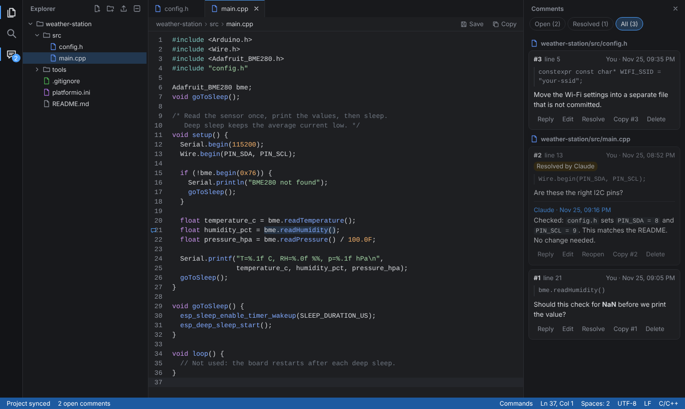
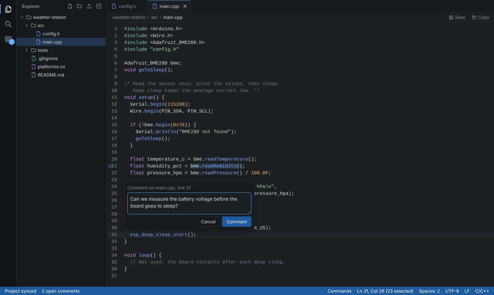
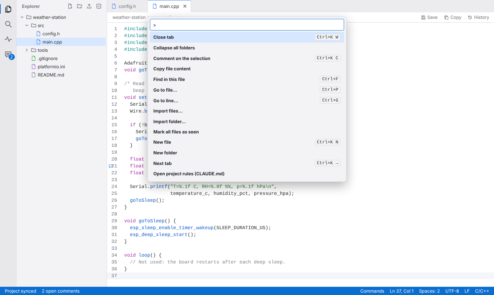
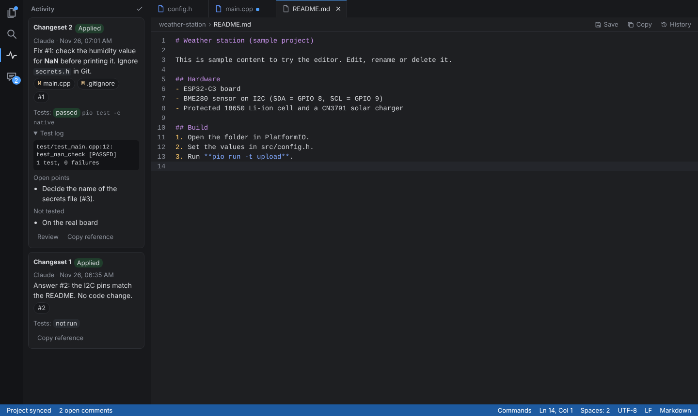
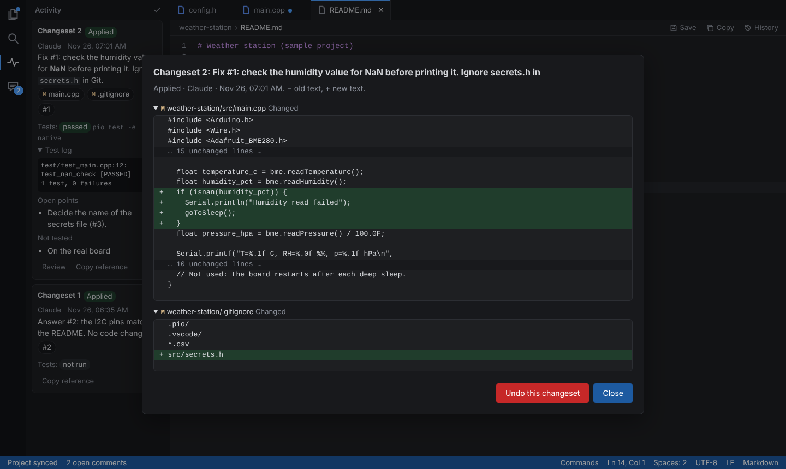
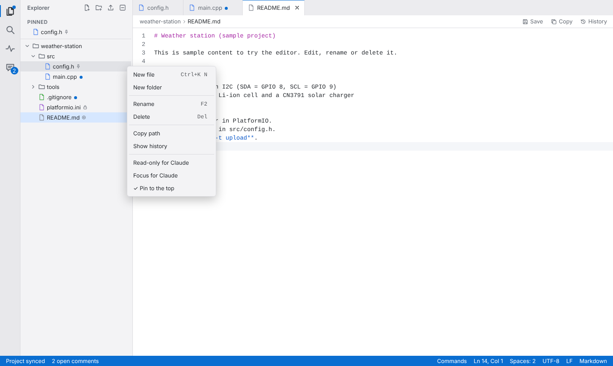

# Mini Code

A small code editor in one HTML file. It looks and works like a simple version of Visual Studio Code (VS Code): an explorer on the left, an editor with tabs in the middle, and search across all files.



*Screenshot with sample content, made automatically with a headless browser.*

You can use Mini Code in two modes:

- **Browser-only mode.** Open `index.html` in a browser, or publish it with GitHub Pages. The files stay in the storage of your browser.
- **Claude artifact mode.** Publish `index.html` as an artifact on claude.ai with a project database. Then Claude can read and write the same files, and you can add comments to code for Claude. Refer to [docs/claude-integration.md](docs/claude-integration.md).

## Features

- Explorer: create, rename, delete and move files and folders. Move them with drag and drop. Import files or a full folder.
- Editor: tabs, line numbers, syntax colors for 15 languages ([list](#supported-languages)), indent and outdent, auto-indent, line comments, undo for each tab.
- Command palette with all commands (`Ctrl+Shift+P`, `⌘⇧P` or `F1`). Go to file and go to line.
- Find and replace in the current file (`Ctrl+F`).
- Search and replace in all files (`Ctrl+Shift+F`): match case, whole word, regular expressions, files to include and to exclude.
- Light and dark theme. Layout for phones.
- Claude artifact mode only: live updates, a conflict bar with a compare view, and comments on selected text (`Ctrl+K` then `C`; macOS: `⌘K` then `C`).
- Claude artifact mode only, from version 0.5.0:
  - File history: the last 5 revisions of each file. Compare a revision with the current text and restore it. Restore deleted files.
  - Activity: one changeset for each Claude turn, with the changed files, comments, test results, open points and items not tested. Review the diff of a changeset and undo it. Apply or reject a proposal.
  - Change markers: a dot marks files that changed since you opened them the last time. The markers are kept for each person and work across devices.
  - Path rules in the Explorer menu: read-only for Claude, focus files for Claude, and pinned files at the top.
  - Comment kinds (note, question, bug, to-do, idea), priorities, "Waiting for you" and "Waiting for Claude", a kind filter, and sorting.
- Claude artifact mode only, from version 0.7.0:
  - Data model version in the project database. A page that is older than the data opens read-only, so it cannot damage data of a newer version. Refer to [docs/data-notes.md](docs/data-notes.md).
  - Package for the jelk package manager (`jelk.json`). jelk installs and updates the page and the skill.

## Supported languages

Mini Code shows syntax colors for these languages. It finds the language from the file extension or the file name.

| Language | File extensions and file names |
|----------|--------------------------------|
| C and C++ (also Arduino) | `.c` `.h` `.cpp` `.cc` `.hpp` `.ino` |
| Python | `.py` |
| JavaScript | `.js` `.mjs` `.cjs` `.jsx` |
| TypeScript | `.ts` `.tsx` |
| Java | `.java` |
| Go | `.go` |
| Rust | `.rs` |
| Shell | `.sh` `.bash` `.zsh`, `Makefile`, `Dockerfile`, `.gitignore`, `.bashrc` |
| HTML and XML | `.html` `.htm` `.xml` `.svg` `.vue` |
| CSS | `.css` `.scss` |
| JSON | `.json` |
| Markdown | `.md` `.markdown` |
| INI | `.ini` `.cfg` `.conf` |
| TOML | `.toml` |
| YAML | `.yml` `.yaml` |

Mini Code shows all other files as plain text. You can edit and search them.

The syntax colors are simple. They show comments, strings, numbers, keywords and function calls. For HTML they also show tags and attributes. For Markdown they also show headings, lists and code. Mini Code does not analyze the code. For `Makefile` and `Dockerfile`, it uses the shell colors as an approximation.

The user interface is in English only.

## Screenshots

All screenshots show sample content. They were made automatically with a headless browser.

| | |
|---|---|
|  |  |
| Comment on selected text. Each comment gets a number, such as #4. | Search and replace in all files, with a preview of each change. |
|  |  |
| The command palette shows all commands and their shortcuts. | Claude replies to comments and resolves them. |
|  |  |
| Activity shows one changeset for each Claude turn (version 0.5.0). | Review the diff of a changeset and undo it. |
|  | |
| Dots mark changed files. The Explorer menu sets the path rules. | |

## Quick start with Claude

Mini Code is a package for the jelk package manager. jelk installs and updates the page and the Claude skill `mini-code` together. Type this in a chat with Claude that has the skill `jelk` (if you do not have it, install jelk first: refer to [github.com/canotir/jelk](https://github.com/canotir/jelk)):

```text
/jelk install mini-code
```

jelk shows the parts of the package and asks for your approval for each part. If you approve the page, jelk creates your first Mini Code artifact. To create more artifacts later, type `/mini-code new`.

Without jelk, use the prompts in [docs/quick-start-prompt.md](docs/quick-start-prompt.md).

To update all parts later, type `/jelk update mini-code`. Use only jelk for updates.

### Command reference

| Command | Action |
|---|---|
| `/mini-code new` | Create a new Mini Code artifact. Claude asks for its name, publishes the page of the installed version and gives you the link. Each artifact has its own files and comments. |
| `/mini-code open` | Select one Mini Code artifact and continue to work with it in this chat. Claude reads the project rules and shows the open comments and the newest changeset. |
| `/mini-code list` | Show all your Mini Code artifacts with name, version and the comparison with the skill (older, same or newer). Changes nothing. |
| `/mini-code` | Ask which of the commands above you want. |
| `/jelk update mini-code` | Update the skill and your Mini Code artifacts to a newer release. Each artifact keeps its link, name, files and comments. |

The commands `/mini-code update` and `/mini-code update-skill` of version 0.6.0 are removed. They now tell you to use jelk.

For details and limits, refer to [docs/skill.md](docs/skill.md). For chats without skills, use the prompts in [docs/quick-start-prompt.md](docs/quick-start-prompt.md).

## Setup

Mini Code has no dependencies and no build step.

1. Download `index.html`.
2. Open it in a current browser (Chrome, Edge, Firefox or Safari).

To use GitHub Pages:

1. In the repository settings, open **Pages**.
2. Select the branch `main` and the folder `/ (root)`.
3. Open the URL that GitHub shows.

## Use

The shortcuts work with all keyboard layouts on Windows, Linux and macOS. Mini Code does not use Alt or Option shortcuts, because these keys type characters on many layouts (for example AltGr or Option+N).

To see all commands, press `Ctrl+Shift+P` (macOS: `⌘⇧P`) or `F1`. The command palette also shows the shortcuts.

| Action | Windows and Linux | macOS |
|--------|-------------------|-------|
| Show all commands | `Ctrl+Shift+P` or `F1` | `⌘⇧P` or `F1` |
| Go to file | `Ctrl+P` | `⌘P` |
| Go to line | `Ctrl+G` | `⌃G` |
| Save · save all | `Ctrl+S` · `Ctrl+Shift+S` | `⌘S` · `⌘⇧S` |
| Find in this file | `Ctrl+F` | `⌘F` |
| Search in files · replace in files | `Ctrl+Shift+F` · `Ctrl+Shift+H` | `⌘⇧F` · `⌘⇧H` |
| Toggle line comment | `Ctrl+/` or `Ctrl+#` | `⌘/` or `⌘#` |
| Toggle sidebar | `Ctrl+B` | `⌘B` |
| New file | `Ctrl+K` then `N` | `⌘K` then `N` |
| Close tab | `Ctrl+K` then `W` | `⌘K` then `W` |
| Previous tab · next tab | `Ctrl+K` then `←` · `→` | `⌘K` then `←` · `→` |
| Comment on the selection (artifact mode) | `Ctrl+K` then `C` | `⌘K` then `C` |
| Toggle comments panel (artifact mode) | `Ctrl+K` then `M` | `⌘K` then `M` |
| Rename · delete (in the explorer) | `F2` · `Del` | `F2` · `⌘⌫` |

Notes:

- On German keyboards, use `Ctrl+#` to toggle a line comment, as in VS Code.
- Shortcuts use the letter that is printed on the key. Thus they also work with AZERTY and QWERTZ layouts.
- Some browsers keep a shortcut for themselves (for example `Ctrl+W`, `⌘W`, `Ctrl+N`). For this reason, Mini Code uses `Ctrl+K` chords. All commands are also in the command palette.

## Limits

- Browser-only mode keeps the files in the local storage of one browser. The limit is approximately 5 MB. Other devices cannot see the files. Make backups.
- Mini Code has no terminal and no Git integration.
- The page cannot start downloads in the claude.ai artifact frame. Use the **Copy** button.
- If a newer version of Mini Code changed the data of a project, an older page can only read that project. Update the page with `/jelk update mini-code`.

## Tests

The tests were done manually and with automated browser scripts (Playwright and headless Chrome) during development. The repository does not contain test scripts at this time.

## Disclaimer

Mini Code is an independent hobby project. It is not affiliated with, sponsored by or endorsed by Microsoft. Visual Studio Code and VS Code are trademarks of Microsoft Corporation. Mini Code does not contain code, icons or other assets from Visual Studio Code.

## License

MIT. Refer to [LICENSE](LICENSE). Mini Code uses no external code, fonts or images. Refer to [NOTICE.md](NOTICE.md).

## AI disclosure

This content was generated with AI support (Claude, Anthropic) and subsequently checked and, where necessary, revised by a human.

- Claude (Anthropic) wrote most of the code and the documentation.
- A human specified the requirements, tested the editor and examined the result.
- Claude made the screenshots automatically with a headless browser. They show sample content. They are not edited.
- Examine the code before you use it for important work.
