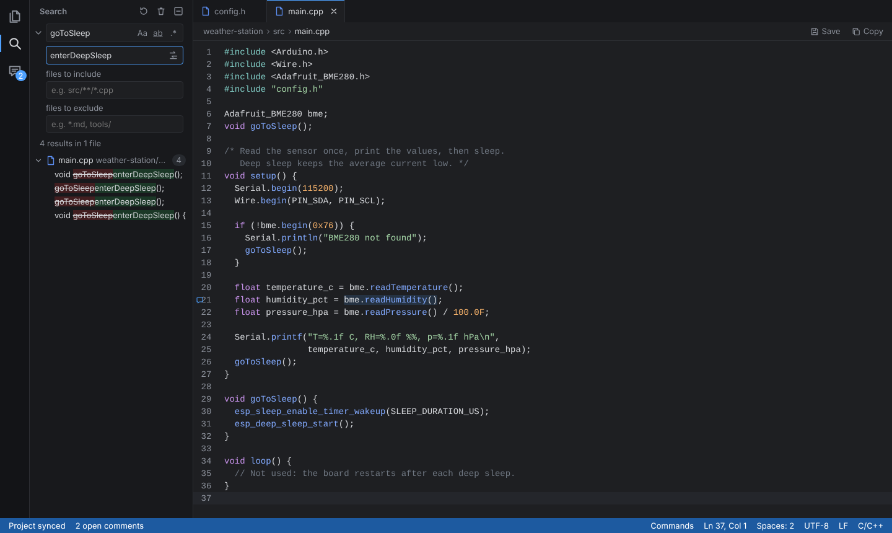

# Mini Code

A small code editor in one HTML file. It looks and works like a simple version of VS Code: an explorer on the left, an editor with tabs in the middle, and search across all files.


*Screenshot with sample content, made automatically with a headless browser.*

You can use Mini Code in two modes:

- **Browser-only mode.** Open `index.html` in a browser, or publish it with GitHub Pages. The files stay in the storage of your browser.
- **Claude artifact mode.** Publish `index.html` as an artifact on claude.ai with a project database. Then Claude can read and write the same files, and you can add comments to code for Claude. Refer to [docs/claude-integration.md](docs/claude-integration.md).

## Features

- Explorer: create, rename, delete and move files and folders. Move them with drag and drop. Import files or a full folder.
- Editor: tabs, line numbers, syntax colors for approximately 15 languages, indent and outdent, auto-indent, line comments, undo for each tab.
- Command palette with all commands (`Ctrl+Shift+P`, `⌘⇧P` or `F1`). Go to file and go to line.
- Find and replace in the current file (`Ctrl+F`).
- Search and replace in all files (`Ctrl+Shift+F`): match case, whole word, regular expressions, files to include and to exclude.
- Light and dark theme. Layout for phones.
- Claude artifact mode only: live updates, a conflict bar with a compare view, and comments on selected text (`Ctrl+K` then `C`; macOS: `⌘K` then `C`).

## Screenshots

All screenshots show sample content. They were made automatically with a headless browser.

| | |
|---|---|
|  |  |
| Comment on selected text. Each comment gets a number, such as #4. | Search and replace in all files, with a preview of each change. |
|  |  |
| The command palette shows all commands and their shortcuts. | Claude replies to comments and resolves them. |

## Quick start with Claude

To set up Mini Code as a claude.ai artifact, copy this prompt into a new chat with Claude. The chat must have a shell and artifact tools. For a second prompt to continue in a new chat, refer to [docs/quick-start-prompt.md](docs/quick-start-prompt.md).

```text
Please set up "Mini Code" for me as an artifact.

1. Download the editor into your workspace with the shell:
   git clone https://github.com/canotir/mini-code-editor
   git -C mini-code-editor checkout v0.4.2
   If you cannot run shell commands or reach GitHub, tell me and stop.
2. Read index.html and docs/claude-integration.md completely before you publish anything.
3. Publish index.html without changes as a new artifact with the title "Mini Code".
4. Declare these capabilities for the artifact:
   {"db": {"rules": [{"path": "", "read": "view", "write": "owner"}]}, "user": {}}
5. Give me the link. Do not write files into the project unless I ask.

When I later ask you to read or change files or comments in Mini Code,
follow docs/claude-integration.md.
```

## Setup

Mini Code has no dependencies and no build step.

1. Download `index.html`.
2. Open it in a current browser (Chrome, Edge, Firefox or Safari).

To use GitHub Pages:

1. In the repository settings, open **Pages**.
2. Select the branch `main` and the folder `/ (root)`.
3. Open the URL that GitHub shows.

## Use

The shortcuts work with all keyboard layouts on Windows, Linux and macOS. Mini Code does not use Alt or Option shortcuts, because these keys type characters on many layouts (for example AltGr or Option+N).

To see all commands, press `Ctrl+Shift+P` (macOS: `⌘⇧P`) or `F1`. The command palette also shows the shortcuts.

| Action | Windows and Linux | macOS |
|--------|-------------------|-------|
| Show all commands | `Ctrl+Shift+P` or `F1` | `⌘⇧P` or `F1` |
| Go to file | `Ctrl+P` | `⌘P` |
| Go to line | `Ctrl+G` | `⌃G` |
| Save · save all | `Ctrl+S` · `Ctrl+Shift+S` | `⌘S` · `⌘⇧S` |
| Find in this file | `Ctrl+F` | `⌘F` |
| Search in files · replace in files | `Ctrl+Shift+F` · `Ctrl+Shift+H` | `⌘⇧F` · `⌘⇧H` |
| Toggle line comment | `Ctrl+/` or `Ctrl+#` | `⌘/` or `⌘#` |
| Toggle sidebar | `Ctrl+B` | `⌘B` |
| New file | `Ctrl+K` then `N` | `⌘K` then `N` |
| Close tab | `Ctrl+K` then `W` | `⌘K` then `W` |
| Previous tab · next tab | `Ctrl+K` then `←` · `→` | `⌘K` then `←` · `→` |
| Comment on the selection (artifact mode) | `Ctrl+K` then `C` | `⌘K` then `C` |
| Toggle comments panel (artifact mode) | `Ctrl+K` then `M` | `⌘K` then `M` |
| Rename · delete (in the explorer) | `F2` · `Del` | `F2` · `⌘⌫` |

Notes:

- On German keyboards, use `Ctrl+#` to toggle a line comment, as in VS Code.
- Shortcuts use the letter that is printed on the key. Thus they also work with AZERTY and QWERTZ layouts.
- Some browsers keep a shortcut for themselves (for example `Ctrl+W`, `⌘W`, `Ctrl+N`). For this reason, Mini Code uses `Ctrl+K` chords. All commands are also in the command palette.

## Limits

- Browser-only mode keeps the files in the local storage of one browser. The limit is approximately 5 MB. Other devices cannot see the files. Make backups.
- Mini Code has no terminal and no Git integration.
- The page cannot start downloads in the claude.ai artifact frame. Use the **Copy** button.

## Tests

The tests were done manually and with automated browser scripts (Playwright and headless Chrome) during development. The repository does not contain test scripts at this time.

## License

MIT. Refer to [LICENSE](LICENSE). Mini Code uses no external code, fonts or images. Refer to [NOTICE.md](NOTICE.md).

## AI disclosure

This content was generated with AI support (Claude, Anthropic) and subsequently checked and, where necessary, revised by a human.

- Claude (Anthropic) wrote most of the code and the documentation.
- A human specified the requirements, tested the editor and examined the result.
- Claude made the screenshots automatically with a headless browser. They show sample content. They are not edited.
- Examine the code before you use it for important work.
